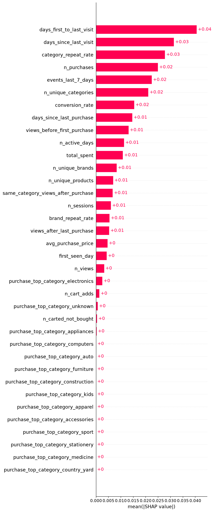
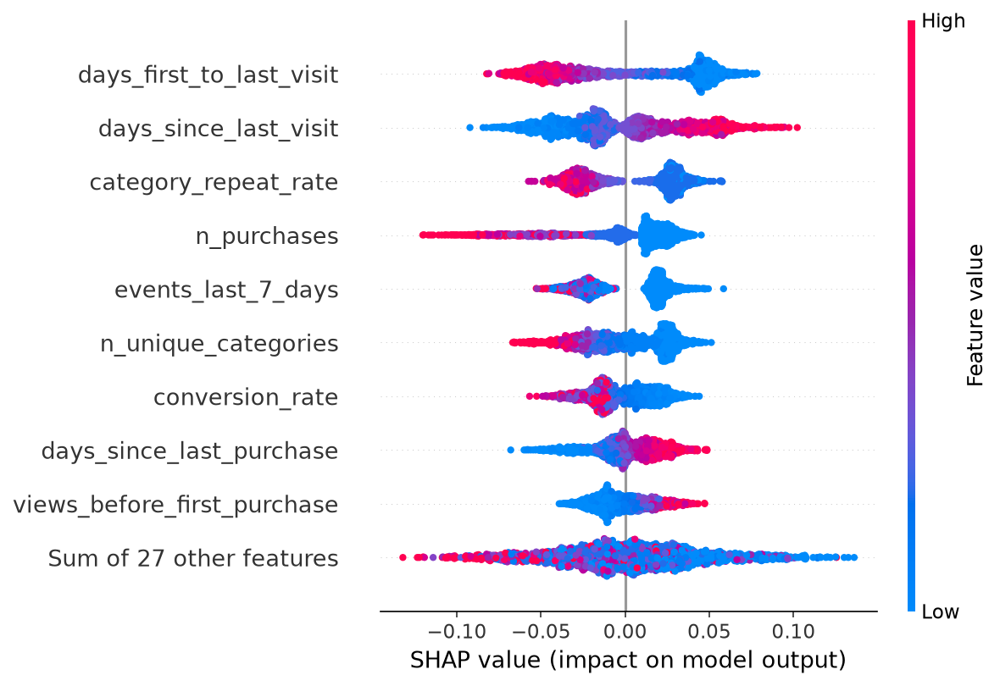

# Customer Churn Prediction

Predicting which e-commerce customers won't buy again. It uses PySpark on ~32 GB of raw click logs, compares several models and class-imbalance methods with MLflow, explains the model with SHAP, and serves predictions with FastAPI.

**Result:** a random forest with ROC-AUC **0.70** on 69k held-out customers. Feature engineering improved it more than switching models or imbalance methods did.

---

## The question

> *Of the customers who bought something in October, which ones won't buy again in the next three months?*

A business could use the answer to target win-back offers at at-risk customers.

## Data

[REES46 eCommerce behavior data from a multi-category store](https://rees46.com/en/datasets). Each row is one click event: `view`, `cart` or `purchase`, with time, product, category, brand, price, user and session.

| File | Size | Used for |
|---|---|---|
| `2019-Oct.csv` | 5.7 GB | **Features** (42.4M events) |
| `2019-Nov.csv`, `2019-Dec.csv`, `2020-Jan.csv` | 26 GB | **Label** only |

October and November are on [Kaggle](https://www.kaggle.com/datasets/mkechinov/ecommerce-behavior-data-from-multi-category-store); December and January come from the publisher's server (`https://data.rees46.com/datasets/marketplace/<month>.csv.gz`). The data isn't included in this repository; put the CSVs in `data/`.

## Defining churn

E-commerce is not a subscription model, therefore churn has to be defined:

- **Customers:** everyone with at least one purchase in October 2019. That's **347,118 users**.
- **Churned (1):** no purchase in November, December or January.
- **Stayed (0):** bought again at least once in that window.
- **No leakage:** features use **October only**. Nov–Jan is used only for the label.

**206,413 churned (59.5%)** and **140,705 stayed (40.5%)**: mild class imbalance, with "stayed" as the minority class.

## Pipeline

```
raw CSVs (32 GB)
  └─ PySpark: clean → October buyers → one row per buyer → + label
       └─ training_table_v2.parquet (347k rows)
            └─ scikit-learn / XGBoost / imbalanced-learn → MLflow
                 └─ SHAP → feature selection → final model (models/churn_model.joblib)
                      └─ FastAPI /predict
```

### Cleaning (October)
| Check | Finding | Action |
|---|---|---|
| Exact duplicate events | 30,220 (0.07%) | Removed |
| Missing `user_id` / `event_type` / `event_time` | 0 | None |
| Missing `category_code` / `brand` | 32% / 14% of rows | **Kept**: not needed for most features; `category_id` is never missing |
| Prices ≤ 0 | 0 | None |

### Features (one row per buyer, October only)

The final model (v3) uses 18 features:

| Group | Features |
|---|---|
| Recency | `days_since_last_purchase`, `days_since_last_visit` |
| Frequency | `n_purchases` (items), `n_sessions`, `n_active_days`, `events_last_7_days` |
| Monetary | `total_spent`, `avg_purchase_price` |
| Breadth | `n_unique_products`, `n_unique_brands`, `n_unique_categories` |
| Behaviour | `conversion_rate` (purchases ÷ max(views, 1)) |
| Timing around purchases | `views_before_first_purchase`, `views_after_last_purchase`, `same_category_views_after_purchase` |
| Tenure | `days_first_to_last_visit` |
| Product type | `category_repeat_rate`, `brand_repeat_rate`: the share of October buyers of that category/brand who bought in 2+ sessions (groups with < 50 buyers use the overall rate) |

## Results

All scores are on the same stratified 20% test set (69,424 customers).

### Feature sets
| Feature set | Features | Best ROC-AUC |
|---|---|---|
| Baseline (always predict "churned") | - | 0.500 (accuracy 59.5%) |
| v1 | 14 | 0.687 |
| v2 | 23 (+9 new) | **0.700** |
| v3 | 18 (v2 minus 5 features with SHAP ≈ 0) | **0.700** |

The 9 new features in v2 added **+0.013 ROC-AUC**. That's more than the gap between the best and worst model type (~0.007). Dropping the 5 weakest in v3 cost nothing.

### Models and class-imbalance methods (v2 features)
| Model | Method | ROC-AUC | Stayers found | Churners found |
|---|---|---|---|---|
| Random forest | none | 0.6995 | 40% | 85% |
| Random forest | class weights | 0.6997 | 62% | 67% |
| Random forest | SMOTE | 0.6997 | 56% | 73% |

Logistic regression and XGBoost scored within ~0.01 of the random forest.

**Findings:**
- **Class weights and SMOTE didn't make the model better.** ROC-AUC is unchanged. They only move the decision line, finding more stayers at the cost of missing more churners. With mild (60/40) imbalance, that's expected.
- **Class weights matched SMOTE** with far less complexity.
- **The business cares about churners, the majority class**, so the final model uses **no rebalancing**. It catches 85% of churners, and its scores stay close to real probabilities.

### What the model learned (SHAP)
Top features, with every effect in the expected direction:
1. **`days_first_to_last_visit`:** customers active over a short window churn. Regulars stay.
2. **`days_since_last_visit`:** a long time since the last visit means churn.
3. **`category_repeat_rate`:** buyers of "repeat-purchase" product types stay.
4. **`n_purchases`:** one-time buyers churn.
5. **`events_last_7_days`:** quiet in the last week means churn.

A less obvious one: lots of views **before** the first purchase predicts churn, probably because a heavily researched purchase is a big one-off (an appliance, a TV).

SHAP shows what the **model relies on** when making its predictions, not what the cause behind churn is.

<p>
  
  
</p>

### Choosing the threshold
The API flags churn at a probability of **≥ 0.5**. The right value depends on business costs:

> **threshold = cost of the retention action ÷ value of acting on a real churner**

 The API returns the probability of churn, so callers can apply their own threshold or take the top-N riskiest customers.

## API

`app/main.py` serves the v3 model.

```bash
uvicorn app.main:app --reload
```

Then open http://127.0.0.1:8000/docs for an interactive test page.

**`POST /predict`** takes one customer's 18 features as JSON:
```json
{
  "days_since_last_purchase": 26, "days_since_last_visit": 22, "n_purchases": 1,
  "n_sessions": 2, "n_active_days": 2, "total_spent": 250.19, "avg_purchase_price": 250.19,
  "n_unique_products": 2, "n_unique_brands": 1, "n_unique_categories": 2,
  "events_last_7_days": 0, "conversion_rate": 0.029, "category_repeat_rate": 0.452,
  "brand_repeat_rate": 0.46, "views_after_last_purchase": 25,
  "same_category_views_after_purchase": 22, "views_before_first_purchase": 9,
  "days_first_to_last_visit": 5
}
```
and returns:
```json
{"churn_probability": 0.746, "churn_prediction": true, "threshold": 0.5}
```

- Inputs are validated with the same ranges as the data pipeline. Invalid or missing fields return **HTTP 422** with the reason.
- The server refuses to start if its input fields don't match the saved model's features.
- `GET /health` returns `{"status": "ok"}`.

## How to run

**Requirements:** Python 3.12, Java 17 (for Spark), ~40 GB free disk space, 8 GB RAM.

```bash
python -m venv .venv
.venv\Scripts\activate
pip install -r requirements.txt
```

| Step | Command | Output |
|---|---|---|
| 1. Explore October | `python src/explore.py` | Printed checks |
| 2. Build features (~15–25 min) | `python src/data_process_v2.py` | `data/training_table_v2.parquet` |
| 3. Start MLflow | `mlflow server --backend-store-uri sqlite:///mlflow.db --default-artifact-root ./mlartifacts --host 127.0.0.1 --port 5000` | UI at http://127.0.0.1:5000 |
| 4. Compare models | `python src/ml_imbalance.py` | 10 runs in MLflow |
| 5. Explain with SHAP | `python src/shap_explain.py` | `shap_*.png`, attached to the MLflow run |
| 6. Train the final model | `python src/train_v3.py` | `models/churn_model.joblib` |
| 7. Serve | `uvicorn app.main:app` | API on port 8000 |

`data_process.py` and `ml_train.py` are the earlier v1 versions of steps 2 and 4.

On Windows, Spark warns about a missing `winutils.exe`. That's harmless here: Spark only reads files, and the results are saved with pandas.

## Project structure
```
app/main.py               FastAPI app
src/explore.py            First look at the raw data + churn label checks
src/data_process.py       v1 feature table (14 features)
src/data_process_v2.py    v2 feature table (23 features) with built-in checks
src/ml_train.py           v1 model comparison
src/ml_imbalance.py       Models × imbalance methods, logged to MLflow
src/shap_explain.py       SHAP charts for the random forest
src/train_v3.py           Final 18-feature model, saved for the API
models/                   Saved model (+ its feature order)
data/                     Raw CSVs and feature tables (not in the repo)
```

## Limitations
- **Christmas:** the Nov–Jan window includes holiday shopping, which probably raises the "came back" rate and adds noise.
- **`n_purchases` counts items, not orders:** one checkout with three items counts as 3.
- **Category names are unreliable from December onward** (e.g. phones labelled `construction.tools.light`). This doesn't affect the model, since categories are only used from October.
- **Probabilities weren't formally checked for calibration**, which the threshold rule assumes.
